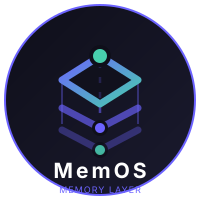

<p align="center">
      
</p>

<h1 align="center">MemOS</h1>

<p align="center">
  <strong>Local-first, persistent memory for AI agents — in a file you own.</strong><br>
  Give Claude Code, Cursor, Codex, or any MCP client a memory that survives restarts.<br>
  One SQLite file. No cloud, no API keys, no vendor lock-in.
</p>

<p align="center">
  <b>English</b> · <a href="translations/README.zh-CN.md">简体中文</a> · <a href="translations/README.es.md">Español</a> · <a href="translations/README.ja.md">日本語</a> · <a href="translations/README.ko.md">한국어</a> · <a href="translations/README.fr.md">Français</a> · <a href="translations/README.de.md">Deutsch</a> · <a href="translations/README.pt-BR.md">Português</a> · <a href="translations/README.ru.md">Русский</a> · <a href="translations/README.hi.md">हिन्दी</a> · <a href="translations/README.ar.md">العربية</a>
</p>

<p align="center">
  <a href="https://www.npmjs.com/package/@mem-os/sdk"></a>
  <a href="https://github.com/Markgatcha/memos/blob/main/LICENSE"></a>
  <a href="https://github.com/Markgatcha/memos/actions"></a>
  
  <a href="https://github.com/Markgatcha/memos/stargazers"></a>
</p>

<p align="center">
  
</p>

<p align="center">
  <a href="https://context-core.dev/memos/"><strong>Website</strong></a> ·
  <a href="https://context-core.dev/docs/"><strong>Handbook</strong></a> ·
  <a href="https://memos.readthedocs.io"><strong>Docs</strong></a> ·
  <a href="https://discord.gg/DyQGgPuueu"><strong>Discord</strong></a> ·
  <a href="https://x.com/Context_Core"><strong>Twitter/X</strong></a>
</p>

## Start here

```bash
npx -y @mem-os/sdk store "Prefers pnpm over npm" --db ./memos.db   # store
npx -y @mem-os/sdk search "package manager" --db ./memos.db        # recall
```

```ts
import { MemOS } from "@mem-os/sdk";

const memos = new MemOS();                          // one SQLite file, zero config
await memos.store("Prefers pnpm over npm");
const hits = await memos.search("package manager");
```

**Works with** Claude Code · Cursor · Codex · Gemini CLI · Hermes · OpenClaw · Cline · Zed · Goose · Kilo · Ollama · LangChain · CrewAI · any MCP client. `memos connect <harness>` writes the config for you — see the [harness matrix](docs/harness-matrix.md).

**Why it is different:** the memory is a single SQLite file on your disk (export it, back it up, delete it) · no network calls required · typed graph edges, temporal validity, trust scores, and provenance · MIT, no paid tier.

### Reproducible retrieval

| Benchmark | Result |
| --- | --- |
| LongMemEval-S, full 500 | **99.4% Hit@20** · 98.3% evidence recall · 96.4% all-evidence@20 |
| ConvoMem, 387 scored | **91.0% Hit@10** · 89.4% evidence recall@10 |
| LoCoMo, full 1,986 | **65.0% Hit@10** · 59.8% evidence recall@10 |

Evidence-ID scored, no LLM judge. The LoCoMo conversations 0–1 subset (304 questions) reaches 79.8% Hit@10; the full-set number is the headline. Canonical source: `website/data/benchmarks.json`, generated from the raw artifacts in `docs/artifacts/`. Commands and caveats: [`benchmarks/README.md`](benchmarks/README.md).

> **New here?** [Ingest your notes in 60 seconds](docs/quickstart-ingest.md) — install, point at a folder, search it.
>
> **Installing?** [Agent-readable install contract](llms-install.md) · [Harness matrix](docs/harness-matrix.md) · [MCP compatibility policy](docs/mcp-compatibility.md) · [per-harness snippets](https://context-core.dev/docs/install)
>
> **Contributing?** [Good first issues](https://github.com/Markgatcha/memos/issues?q=is%3Aissue+is%3Aopen+label%3A%22good+first+issue%22) · [CONTRIBUTING.md](CONTRIBUTING.md) · [open benchmark leaderboard](docs/benchmark-leaderboard.md)

## Install

```bash
# TypeScript / Node.js
npm install @mem-os/sdk

# or run it without installing
npx -y @mem-os/sdk init --yes

# Python HTTP server
pip install mem-os-python
memos-server            # http://localhost:7400
```

The npm package tracks tagged releases and can briefly lag `main`. The GitHub source is the canonical, always-current build (v1.6.27). For the latest source build, see [Installation](docs/installation.md).

## Connect a harness

```bash
npx -y @mem-os/sdk connect claude-code --write
npx -y @mem-os/sdk connect cursor --write
npx -y @mem-os/sdk connect codex --write
```

`connect` writes the real MCP config, keeps a backup, and prints the restart step. For every supported harness, see the [harness matrix](docs/harness-matrix.md).

## What you get

| Capability | What it means |
| --- | --- |
| One file you own | A single SQLite database; copy it, back it up, encrypt it, delete it |
| Hybrid retrieval | SQLite FTS5 + embeddings, fused and relevance-gated |
| Graph memory | Typed edges: `relates_to`, `contradicts`, `supports`, `derived_from`, `temporal_precedes` |
| Temporal validity | `validFrom` / `validTo` and point-in-time search |
| Trust and provenance | Source, trust score, version timeline, quarantine queue |
| Context packs | Token-budgeted memory bundles with citations |
| Consolidation | Dedupe, archive, summarize clusters, decay stale memories without losing history |
| MCP native | stdio and Streamable HTTP, with a published compatibility policy |
| Four surfaces | TypeScript SDK, CLI, MCP server, HTTP API — all on the same store |
| Adapters | OpenAI, Anthropic, Vercel, LangChain, CrewAI, Ollama |
| Portability | Import ChatGPT/Claude memory, export JSON/Markdown/Obsidian, backup/restore |
| Image memory | Captions plus optional CLIP pixel search |

## Documentation

| I want to… | Read |
| --- | --- |
| Install in five minutes | [Installation](docs/installation.md) |
| Point it at my notes | [Ingest your notes](docs/quickstart-ingest.md) |
| Connect my coding agent | [Harness matrix](docs/harness-matrix.md) |
| Understand nodes, trust, time, packs | [Memory model](docs/concepts.md) |
| Look up a command, tool, or route | [CLI](docs/reference/cli.md) · [MCP tools](docs/reference/mcp-tools.md) · [HTTP API](docs/reference/http-api.md) |
| Operate a store | [Security model](docs/security-model.md) · [Operations](docs/operations.md) |
| See benchmark details | [Results in plain English](docs/benchmark-results.md) |
| Understand the architecture | [ARCHITECTURE.md](ARCHITECTURE.md) |
| See what is planned | [ROADMAP.md](ROADMAP.md) |

## Benchmarks

Retrieval-only, evidence-ID scored, no reader model and no LLM judge:

| Benchmark | Result |
| --- | --- |
| LongMemEval-S, full 500 | **99.4% Hit@20** · 96.4% all-evidence@20 |
| ConvoMem, 387 scored | **91.0% Hit@10** · 89.4% evidence recall@10 |
| LoCoMo, full 1,986 | **65.0% Hit@10** · 59.8% evidence recall@10 |

End-to-end is reported separately: **78%** on a 50-question LongMemEval-S sample, self-judged with the same model. It is not comparable to vendor numbers produced with a gpt-4o judge.

The full methodology, per-category breakdowns, and the reproducible leaderboard live in [Benchmark Results](docs/benchmark-results.md) and [`benchmarks/README.md`](benchmarks/README.md). Raw artifacts are committed under `docs/artifacts/`.

## Part of the AI Trio

| Project | Role |
| --- | --- |
| **[universal-mcp-toolkit](https://github.com/Markgatcha/universal-mcp-toolkit)** | MCP transport, server registry, and tool routing |
| **[memos](https://github.com/Markgatcha/memos)** | Graph-based persistent memory across sessions |
| **[llm-guardian](https://github.com/Markgatcha/llm-guardian)** | Token folding, budgets, and provider proxies |

Each project works standalone. The integrations are optional: `umt link memos` exposes this store as an MCP server, and Guardian can inject a MemOS context pack when `MEMOS_NAMESPACE` is set. Nothing here requires the other two.

## Contributing

- [Good first issues](https://github.com/Markgatcha/memos/issues?q=is%3Aissue+is%3Aopen+label%3A%22good+first+issue%22)
- [Contributing guide](CONTRIBUTING.md)
- [Discord](https://discord.gg/DyQGgPuueu)
- [Security policy](SECURITY.md)

## License

[MIT](LICENSE) — use it anywhere, for any purpose, no attribution required.
